# ManyChat Setup: Sonia Ribas

What is configured in ManyChat today, as far as the DM AI is concerned. It sits beside the
Operating Manual: the manual says how the AI should behave, this file says what ManyChat actually
does around it.

Source: read-only audit of the ManyChat workspace, 18 Oct 2026. Server facts are checked against
`app/api/webhook.py` and `app/worker.py`.

## 1. Account

- One workspace: **Sonia Ribas | Fertility Coach**, Pro plan, Pacific time.
- Instagram **@soniaribascoach** is connected through **Instagram OAuth, not Meta for Business**.
- **@thefertilitysolution is not connected** to this workspace. It only appears as a test username.
- No separate sandbox account. Testing uses a username allowlist (section 2).
- TikTok and Messenger are connected but never call the AI.

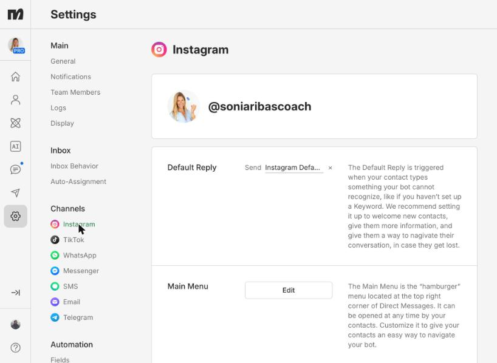

## 2. How a DM reaches the AI

**Instagram Default Reply** (live). It fires on every DM that no keyword matched. Story replies
are off.

1. Condition "If Beta Users": `ig_username` is one of `aliiqbal028`, `confessionsofacookiehustler`,
   `iamreggie23`, `betopull`, `thefertilitysolution`, `codemintoffical` (case sensitive;
   `codemintoffical` is probably a typo).
2. Match: External Request, `POST .../webhook/` (trailing slash), JSON body
   `{{subscriber_data|to_json:true}}`, **no headers**.
3. No match: nothing. **Everyone outside the allowlist gets no reply.**

The server reads `id`, `ig_id` and `last_input_text` from the top level of that body, queues the
message, and replies later through `sendContent`. The response mapping (`$.reply` into
`Test_Field`) does nothing, because the server returns only `{"status": "ok"}`.

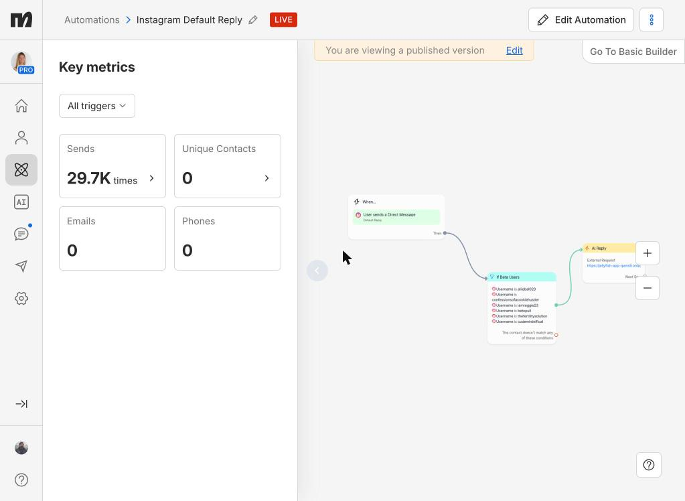
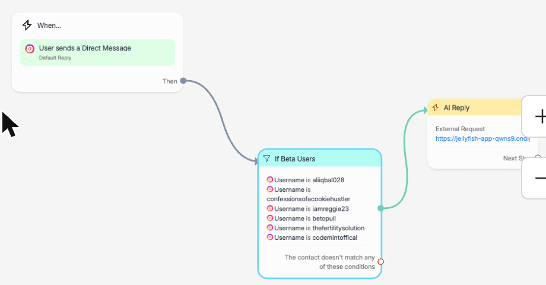

**Release (Resume AI)** (live). Rule: tag **Resume AI** (91125448) is added. Same allowlist, then
`POST .../webhook/resume` with the same body and no headers. It never sends `approve_age`, so age
approval is only possible from our admin page. The tag is never removed, so a second release of
the same contact needs someone to remove it first.

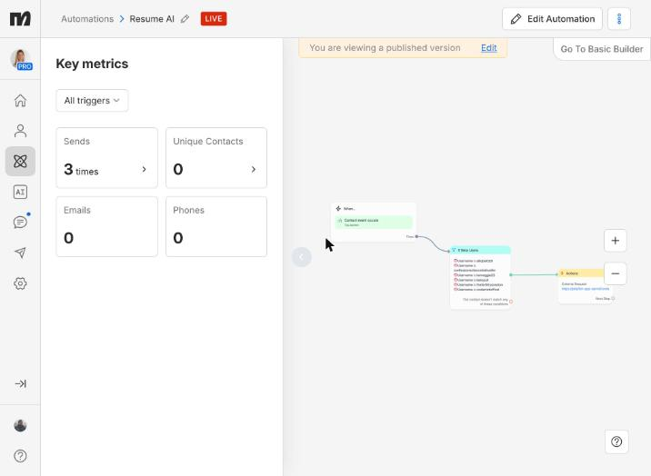
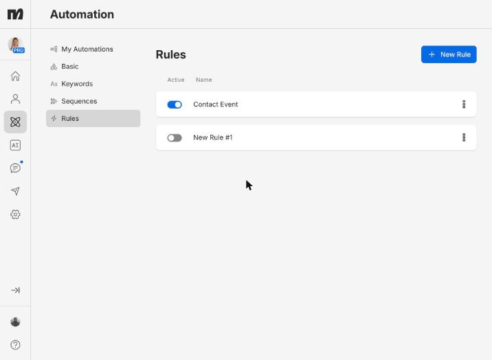

**Signature:** neither request sends a header. Both work only because `MANYCHAT_WEBHOOK_SECRET` is
unset on the server, which makes the server skip the check (`webhook.py:20`). Today anyone who
knows the URL can post a message or release a lead.

## 3. Tags the AI uses

| Tag | ID | Set by | What ManyChat does with it |
|---|---|---|---|
| `human_handover` | 86596410 | Server, on every handoff | **Nothing.** No assignment, notification or pause. |
| Resume AI | 91125448 | Reggie, by hand | Calls `/webhook/resume` (section 2) |
| Qualified | ? | Server, using `qualified_tag_id` from admin settings | No tag named "qualified" exists. If the setting is empty the server falls back to `human_handover`. |

There is no opted-out, existing client or human-owned tag. The other 17 tags (TTC duration,
diagnosis, urgency, readiness, fit, `link_clicked`) are not used by the AI.

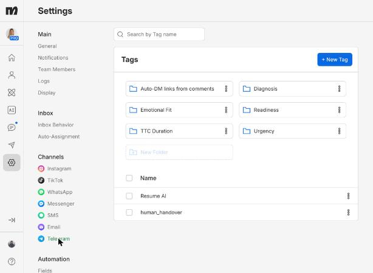

## 4. Other automations that DM people

| Automation | Trigger | Ends with | Risk for the AI |
|---|---|---|---|
| AMH / Megan Guide (3 variants) | IG comment "AMH" or "Megan" on 2 reels, story reply "MEGAN" | Collects name and email (ActiveCampaign list 59), asks how long she has been trying, **assigns to Reggie** | Her next DM goes to Default Reply, so the AI also answers a chat Reggie owns. The AI never sees the flow's messages. |
| SUMMIT links | IG comment "SUMMIT" on one post | Sends the summit link, then a **30 minute** follow-up if `link_clicked` is missing | The follow-up does not check opt-out or `human_handover`. Her answer goes to the AI. |

Everything else is off, draft, or TikTok only. There are **no DM keyword automations** (no AMH,
GLOW, PLAN, PREGNANT), no welcome message, no ice breakers and no broadcasts. Single-word DMs
therefore reach the AI through Default Reply, which is what our opener call expects.

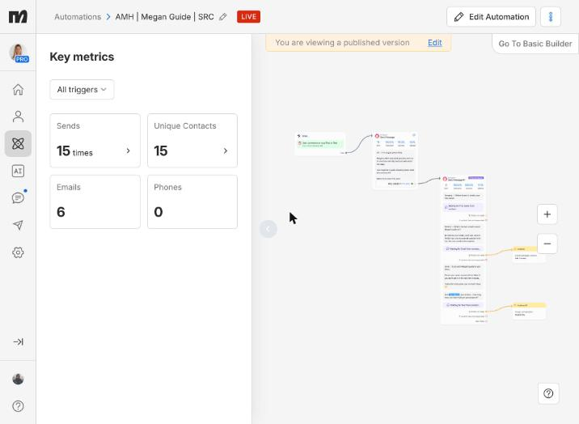

## 5. Team and handoff

- **Reggie Ray** is an Inbox Agent with 63 assigned chats. He gets "assigned to me" alerts by
  email (and possibly mobile push), only from the Megan flows.
- Inbox: **any message starts a conversation**, so Unassigned holds about 74,000 chats. There is no
  folder or label for handoffs or unanswered leads.
- Auto-assignment is off (needs a plan upgrade).
- Automation pauses for **30 minutes** when an agent replies from the ManyChat Inbox. Whether
  replies from the Instagram app or Meta Business Suite trigger it is unknown.
- No Slack or other notification on handoff.

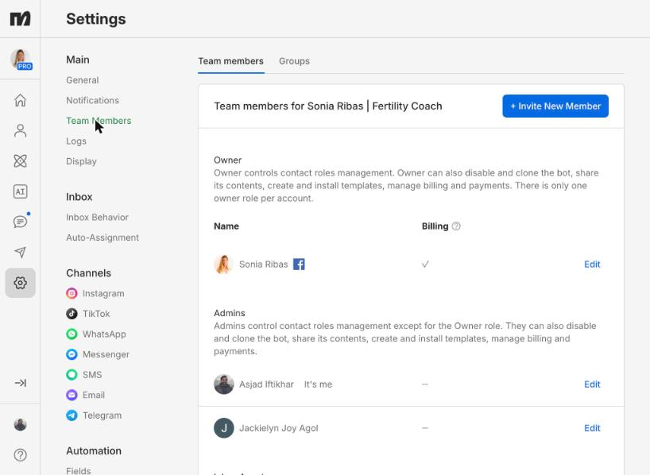
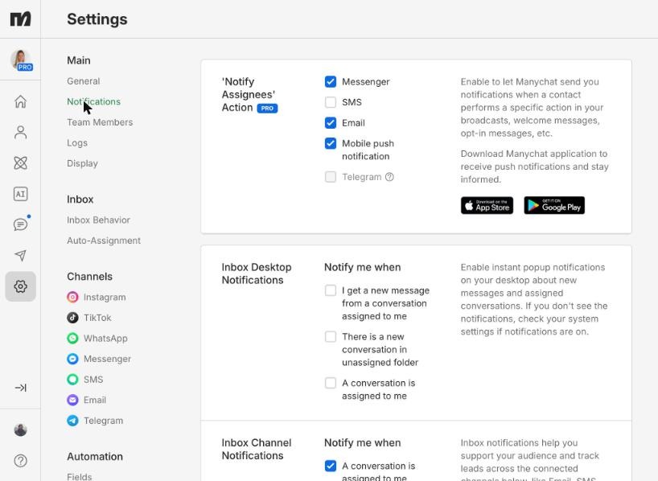
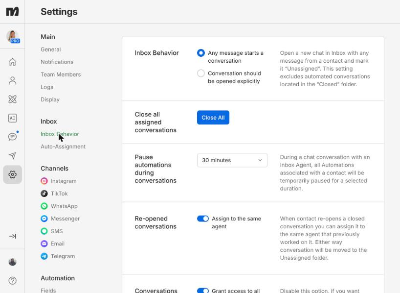
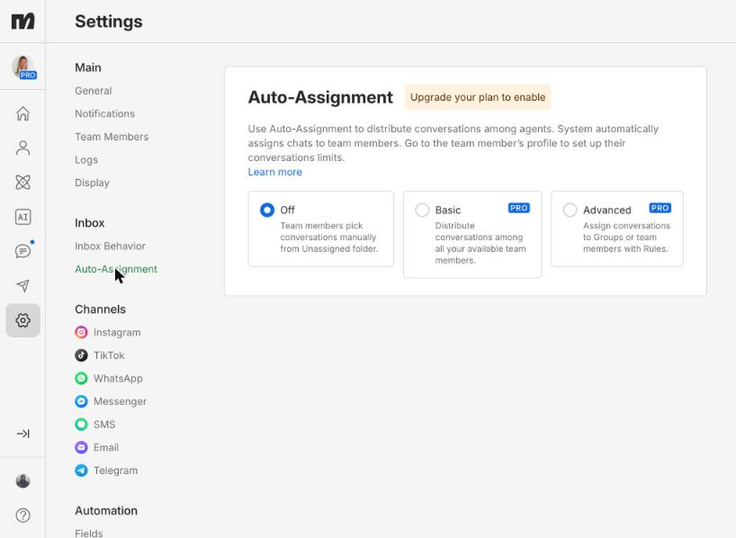
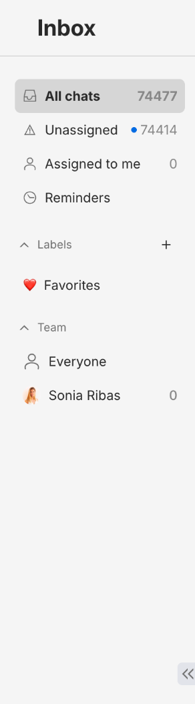

## 6. Opt-out

ManyChat's built-in "Stop" and "Unsubscribe" keywords unsubscribe the contact inside ManyChat.
Nothing tells the server, and no tag is added. The server records its own opt-out when the AI
reads STOP, but only for allowlisted contacts.

## 7. Follow-ups and links

- The only delayed message is the SUMMIT 30 minute follow-up.
- No masterclass, replay or "didn't book" follow-up exists. The Lead Generation sequence is empty.
- No booking, masterclass or replay link appears in any automation, and no booking integration
  (no Calendly). Booking confirmations never come back to ManyChat or the server.
- No message tag (Human Agent or other) is set.

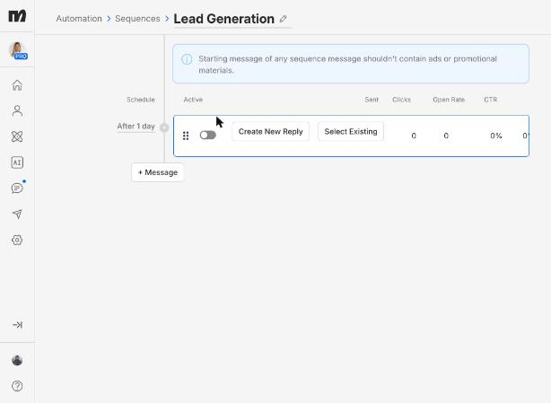

## 8. Follow to DM

Unavailable on @soniaribascoach: "To use this automation, you need to update Instagram
permissions." Likely fix is reconnecting through Meta for Business (unconfirmed). @thefertilitysolution
could not be checked.

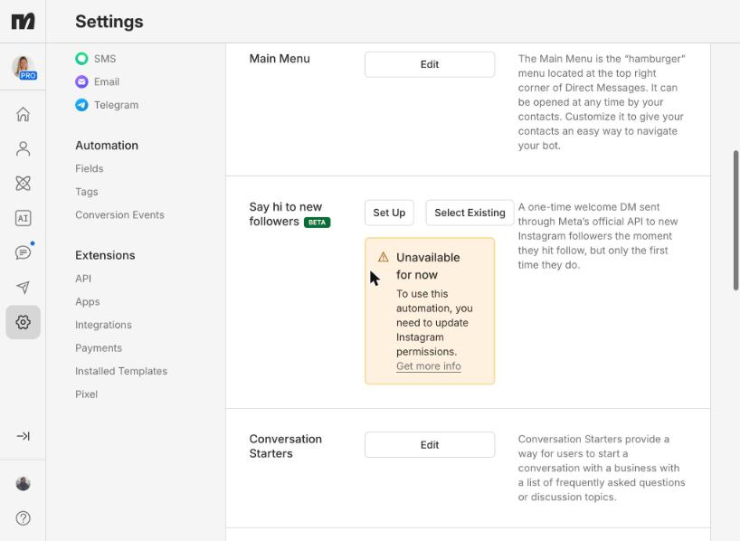

## 9. Pausing everything

No single switch. Turning off the Instagram Default Reply stops all AI replies; disabling the
Instagram channel stops all Instagram automation.

## 10. Gaps for launch

1. Remove the allowlist, or the AI is live for nobody.
2. Default Reply must skip contacts tagged `human_handover` (and a new opted-out tag), so the AI and
   Reggie never both answer.
3. Set `MANYCHAT_WEBHOOK_SECRET` and send it as an `X-Manychat-Secret` header from both requests.
   The `/webhook` route accepts only the HMAC header today, so it needs the same header option
   `/webhook/resume` already has.
4. Point the request at `/webhook`, without the trailing slash.
5. A rule on `human_handover` that assigns to Reggie and notifies him, so handoffs have an owner
   and a queue.
6. Resume flow: remove the Resume AI tag and `human_handover` after the call, so release can repeat.
7. Opt-out: tag the contact in ManyChat and exclude the tag from every flow, including the SUMMIT
   follow-up.
8. Decide whether the Megan flows hand off to Reggie, to the AI, or to both.
9. Create the qualified tag and save its ID as `qualified_tag_id`.
10. Follow to DM: Meta for Business reconnect, and confirm whether @thefertilitysolution has its own
    workspace.

## Open questions

1. Is there a separate workspace for @thefertilitysolution, and who owns it?
2. Where does Reggie reply from: ManyChat Inbox, Instagram app or Meta Business Suite?
3. Should the Megan flows end with Reggie, the AI, or both?
